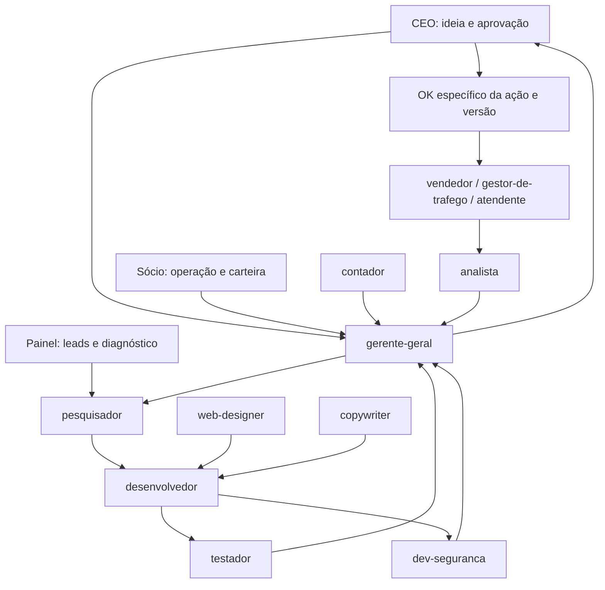

# Mapa do projeto

Atualizado em 03/11/2026 com base em arquivos locais e consulta ao Graphify.

## Aplicação observada

| Entrada/componente | Responsabilidade e relações |
| --- | --- |
| `app/main.py` | Cria FastAPI, inicializa/migra base, registra routers e serve `app/static/`. Sua importação pode alterar a base configurada. |
| `app/static/index.html`, `app.js`, `styles.css` | Interface do painel no navegador. |
| `app/routers/leads_router.py` | API de leads, buscas e relatórios; usa banco e serviços. |
| `app/routers/outreach_router.py` | Enfileira, lista, reserva e atualiza contatos; usa `database.py`. Fila não comprova envio ou aprovação humana. |
| `app/database.py`, `app/models.py` | Persistência SQLite e modelos/validação. |
| `app/services/maps_scraper.py` | Scraper, importação e dados de simulação; motor Docker é dependência operacional opcional. |
| `app/services/business_discovery.py`, `site_xray.py` | Descoberta e diagnóstico por consultas externas. |
| `app/services/lead_scorer.py`, `outreach_generator.py` | Classificação, mensagens e relatórios a partir dos leads. |
| `app/services/niches_catalog.py` | Catálogo de nichos. |
| `tests/` | Testes existentes da API, banco, serviços, interface e instalador. |
| `requirements.txt`, `docker-compose.yml` | Dependências Python e configuração do motor externo. |

Inicialização documentada: `python -m uvicorn app.main:app --host 127.0.0.1 --port 8090 --reload`. Testes existentes usam `pytest`; não foram executados nesta tarefa exclusivamente documental.

## Camada de agentes

`.claude/agents/` contém os 12 papéis solicitados. `docs/EMPRESA_DE_AGENTES.md` define o fluxo, repasses e aprovação. Não existe conexão nova entre esses arquivos e os endpoints do painel nesta entrega.

As setas indicam repasse de trabalho, não chamadas automáticas de software. O gerente distribui tarefas aos demais especialistas conforme necessidade.

## Contexto, Git e Graphify

- `AGENTS.md`: entrada curta para instruções e documentos canônicos.
- `.agents/rules/`: regras históricas locais; aplicar precedência das instruções atuais do usuário sobre staging, upstream e tarefas pequenas.
- `Sprint atual.md`: histórico da correção anterior e registro separado desta tarefa.
- `graphify-out/wiki/index.md`, `graph.json`: mapa e grafo existentes. Graphify está disponível e sua consulta retornou relações entre routers, banco e serviços. Contagens históricas da wiki não foram tratadas como atuais.
- Não houve alteração de código nesta tarefa; nenhuma atualização AST foi necessária. Agentes Markdown e seus repasses estão mapeados aqui, sem presumir suporte do Graphify a papéis organizacionais.
- Branch observada: `main`; remoto `origin` configurado; upstream ausente. Commit e push pendentes. O hook `post-commit` executa push; o helper atual faz staging amplo e não deve ser usado sob as instruções atuais.
- Ficha externa do Operador consultada como contexto histórico; não sincronizada nesta entrega local. Estado atual deve ser confirmado pelos arquivos do projeto, não inferido da ficha antiga.
