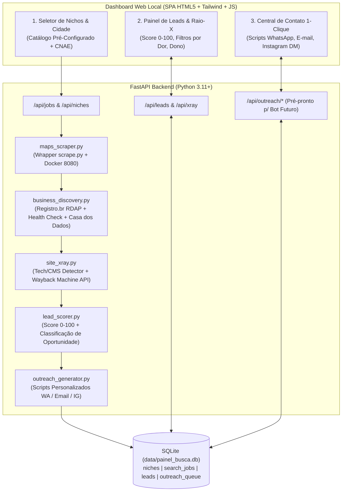

# Especificação Arquitetural — Painel de Busca, Raio-X e Prospecção de Leads

- **Data**: 2026-10-28
- **Projeto**: Painel de Busca (`c:\Projetos Quecine\Painel de Busca`)
- **Repositório**: `https://github.com/Gallo41/painel-de-busca.git`
- **Status**: Aprovado

---

## 1. Visão Geral e Objetivo

Sistema web local (com banco SQLite e API REST pronta para automação futura) desenvolvido para dois sócios freelancers prospectarem clientes de **Criação de Sites/Landing Pages**, **Reforma/Modernização de Sites** e **Sistemas Web Sob Medida (Mais Complexos)**.

O sistema integra nativamente a skill **`google-maps-scraper`** (`Mahanaicoach/google-maps-scraper-kit` + container Docker `gosom/google-maps-scraper` + `scripts/scrape.py`) com as **8 ferramentas de prospecção e diagnóstico** da metodologia de vendas local:

### Coluna 1 — Achar o Negócio (`business_discovery`)
1. **Google Maps (`google.com/maps`)**: Filtra o nicho por cidade/coordenadas (com suporte a grade `--grid`), extrai os 8 campos principais (`title`, `phone`, `emails`, `website`, `category`, `address`, `review_rating`, `review_count`) + enriquecimento de e-mails profundos (`contact`/`about`) e redes sociais (`instagram`, `facebook`, `linkedin`). Identifica imediatamente quem **não tem site** ou usa apenas link de rede social/Linktree.
2. **Casa dos Dados (`casadosdados.com.br`)**: Busca/importação e gerador de filtros inteligentes de empresas recém-abertas por cidade e CNAE/atividade, permitindo prospectar negócios novos antes da concorrência.
3. **Registro.br (`registro.br`)**: Consulta automática via protocolo oficial **RDAP** (`https://rdap.registro.br/domain/<slug>.com.br`) para verificar se o domínio `.com.br` com o nome da empresa está **livre para registro** (`HTTP 404` = disponível; `HTTP 200` = registrado).
4. **DownForEveryoneOrJustMe (`downforeveryoneorjustme.com`)**: Health check HTTP/HTTPS e SSL em tempo real que confirma se o site cadastrado pela empresa está **fora do ar**, com DNS inválido, erro 4xx/5xx ou certificado SSL expirado.

### Coluna 2 — Raio-X do Site Atual (`site_xray`)
5. **BuiltWith (`builtwith.com`)**: Fingerprinting local de stack tecnológica (servidores, frameworks, analytics, pixels, widgets de WhatsApp/chat) + link direto de 1-clique para relatório BuiltWith.
6. **Wappalyzer (`wappalyzer.com`)**: Leitura instantânea das tecnologias carregadas na página ( bibliotecas JS, construtores, tags de conversão, responsividade mobile `viewport`).
7. **WhatCMS (`whatcms.org`)**: Identificação precisa do CMS/Construtor (**WordPress**, **Wix**, **Squarespace**, **Shopify**, **Webflow**, **Joomla**, **Linktree/Bio**, **HTML Estático**) + detecção de **Oportunidade de Sistema Complexo** (empresas com alto volume de avaliações no Maps, mas apenas com site institucional básico sem agendamento, portal do cliente ou catálogo).
8. **Web Archive (`web.archive.org`)**: Consulta à API oficial do **Wayback Machine** (`https://archive.org/wayback/available?url=...`) para verificar a idade do site e há quanto tempo não recebe atualizações.

---

## 2. Arquitetura do Sistema

---

## 3. Modelo de Dados (SQLite)

1. **`niches`**:
   - `id`, `name`, `category_group` (`Saúde`, `Jurídico & Contábil`, `Serviços Locais`, `Beleza & Estética`, `Imobiliário & Construção`, `Gastronomia & Comércio`), `search_terms` (JSON array), `cnae_codes` (JSON array), `recommended_offer` (`SITE_NOVO`, `REFORMA_SITE`, `SISTEMA_COMPLEXO`), `active` (0/1).
2. **`search_jobs`**:
   - `id`, `city`, `state`, `niche_ids` (JSON), `keywords` (JSON), `depth`, `grid_size`, `include_socials`, `status` (`pending`, `running`, `completed`, `failed`), `total_found`, `created_at`, `completed_at`, `error_message`.
3. **`leads`**:
   - Dados do Negócio: `id`, `job_id`, `niche_id`, `title`, `category`, `phone`, `whatsapp_clean`, `emails`, `website`, `address`, `city`, `review_rating`, `review_count`, `instagram`, `facebook`, `linkedin`, `cnpj`, `opened_date`, `source` (`google_maps` | `casadosdados` | `manual`).
   - Dados do Raio-X (`xray_json` + colunas indexadas):
     - `has_website` (bool), `is_social_only_url` (bool), `site_In_air` (bool), `http_status` (int), `has_ssl` (bool), `response_time_ms` (int).
     - `suggested_domain` (ex: `clinicaexemplo.com.br`), `domain_available_br` (bool).
     - `detected_cms` (ex: `Sem Site`, `Linktree/Bio`, `Wix`, `WordPress`, `HTML Estático`), `tech_stack` (JSON), `has_whatsapp_widget` (bool), `has_analytics_pixel` (bool), `is_mobile_friendly` (bool), `has_complex_system` (bool).
     - `wayback_first_seen`, `wayback_last_seen`, `external_tools_links` (JSON com links diretos para `builtwith`, `wappalyzer`, `whatcms`, `wayback`, `registro_br`, `downforeveryone`, `casadosdados`).
   - Qualificação e Gestão:
     - `opportunity_score` (0–100), `primary_pain` (`SEM_SITE`, `DOMINIO_LIVRE`, `SITE_FORA_DO_AR`, `SITE_AMADOR_ANTIGO`, `OPORTUNIDADE_SISTEMA`), `recommended_service`, `pain_summary`.
     - `assigned_to` (`"nao_atribuido"`, `"eu"`, `"amigo"`), `lead_status` (`"novo"`, `"analisado"`, `"contatado"`, `"respondeu"`, `"reuniao"`, `"fechado"`, `"descartado"`), `notes`.
4. **`outreach_queue`** (Pré-pronto para automação futura):
   - `id`, `lead_id`, `channel` (`whatsapp`, `email`, `instagram`), `recipient`, `subject`, `message_body`, `diagnostic_context` (JSON), `status` (`ready`, `queued`, `sending`, `sent`, `replied`, `failed`), `scheduled_for`, `sent_at`, `external_message_id`, `webhook_response`.

---

## 4. Tratamento de Erros e Limites

- **Motor Docker Offline**: Se `localhost:8080` não estiver ativo, o sistema informa claramente no Dashboard com botão de health check e permite também:
  1. Subir o container via comando/endpoint,
  2. Importar CSV/JSON já gerado pelo `scrape.py`, ou
  3. Rodar o Raio-X completo sobre leads cadastrados/importados ou gerados no modo de simulação/demonstração realista para testes locais imediatos.
- **Timeouts em Sites de Terceiros**: Todas as consultas externas (Registro.br RDAP, HTTP check do site do cliente, Wayback Machine) usam timeout curto (5–8s) e fallback gracioso sem travar a fila.
